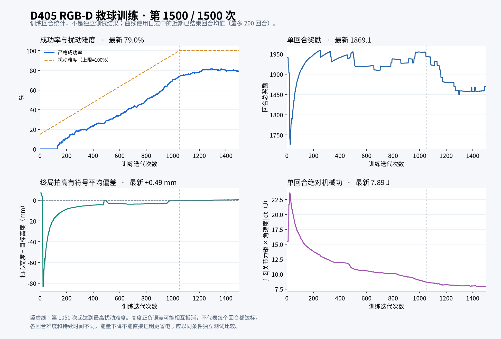

# Panthera-HT Ping-Pong Balance

Panthera-HT 六轴机械臂的 MuJoCo 乒乓球平衡与救球训练。包含 Follower URDF/网格、场景生成、PPO、D405 感知、已训练权重和独立评估结果。

推荐版本是 **D405 RGB-D 救球策略**：允许球拍下降接球，再使球回到拍心、拍面回到目标高度，并考虑机械功率消耗。另保留纯 RGB 平衡策略；两者输入不同，不能直接比较训练轮数。

## 快速开始

需要 Python 3.12、可用的 OpenGL 环境和 [uv](https://docs.astral.sh/uv/)。在 Linux 桌面终端执行：

```bash
git clone https://github.com/wEch1ng/Panthera-HT_pingpong-balance.git
cd Panthera-HT_pingpong-balance
uv sync --locked --extra plots

# 使用当前桌面会话的 DISPLAY/XAUTHORITY。
export MUJOCO_GL=glfw
export PYOPENGL_PLATFORM=glx

uv run python -m sim.build_model
uv run python -m sim.view_controller --controller weights/d405_rgbd_recovery.pt --camera
```

模型由 `assets/description/` 中的 URDF 和网格生成至 `assets/panthera/`，不依赖仓库外的 SDK 文件夹。生成文件不纳入 Git；修改 URDF 或夹持参数后重新运行 `sim.build_model`。

主窗口是自由视角，小窗是腕部相机。鼠标旋转/平移/缩放，**R** 重置到下一随机场景。默认连续运行；球触地、离拍心超过 50 cm、违反救球环境限制或仿真异常时结束回合。`--strict-episodes` 启用有限回合（RGB-D 20 秒、旧平衡环境 10 秒）。

演示目标为 1 倍实时速度，渲染耗时过长时会慢于实时。物理时间步不会因此改变。无桌面服务器可使用可用的 EGL 后端；本次实验机器的 EGL 扩展不可用，采用桌面 GLFW 隐藏渲染上下文训练。

## 任务和观测

- 目标球位置是**拍面坐标** `(u,w)=(0,0)`，目标拍心世界高度为 `z=0.527232155 m`。没有固定世界 XY 返回目标。
- 六轴动作是关节目标角度增量，30 Hz，范围 ±1，缩放为 0.04 rad。物理步长 1/480 秒，每个控制步执行 16 个物理子步。
- 夹爪开口 30 mm，球拍向内插入 30 mm，刚性固定；不模拟夹紧力或摩擦抓握。
- 保留 URDF 关节角、力矩限制，伺服有受限的重力/科氏力补偿。救球任务监测 URDF 速度上限，实测子步超速会终止；这不等同于实机硬限速。
- 奖励鼓励接住、回中心、回高度；能耗项为平均 `sum(abs(tau*qdot))`，另有小的力矩平方与动作变化惩罚。它是**机械功代理量，不是实测电耗或热损耗**。

RGB-D 使用颜色检测、深度球面拟合和短时跟踪估计球的三维运动。策略 MLP 不直接接收图像，也不读取仿真球真值；真值仅用于奖励、重置和评估。

| 输入 | 维数 |
| --- | ---: |
| 球的拍面内位置 u/w、速度 vu/vw | 4 |
| 六关节相对默认姿态的角度偏移 | 6 |
| 六关节角速度 | 6 |
| 最近三步六轴动作 | 18 |
| 球心法向位置、法向速度 | 2 |
| 可见性、丢失时长 | 2 |
| 拍高目标误差、拍心竖直速度 | 2 |
| 指定拍面目标中心 u/w | 2 |
| **合计** | **42** |

相机分辨率 128×96，垂直 FOV 58°，水平 FOV 约 72.9°，尚未按实机完整视野或内参标定。仿真 RGB/深度对齐，训练加入图像随机化、毫米级位置噪声和丢帧；未验证真实 D405 深度噪声，也未接入实机驱动。

纯 RGB 平衡版本使用 `RGB → detector → MLP → 平滑差分速度 → PPO`，策略输入 34 维：

```bash
uv run python -m sim.view_controller --controller weights/d405_rgb_balance.pt \
  --estimator weights/d405_rgb_estimator.pt --camera
```

RGB-D 策略不要传 `--estimator`，它使用自己的三维跟踪器。

## 训练

运行本次救球配置，并在训练后自动对初始与最终权重分别评估：

```bash
uv run bash sim/run_recovery_v1.sh
# 已存在同名训练时，使用另一个名称：
RECOVERY_RUN=my_recovery_v2 uv run bash sim/run_recovery_v1.sh
```

从 `weights/d405_rgb_balance.pt` 初始化，扩展观测输入，新增输入权重设零；使用新优化器，训练 1500 次，1050 次达到最高扰动难度。包含平衡、快速滚动、下落、低拍面回升及随机推球；最高初始横向速度 0.35 m/s、额外下落间隙 0.12 m、向下初速度 0.45 m/s、推球速度增量 0.25 m/s。并非所有组合都物理可救或始终可见。

自定义训练与续训：

```bash
uv run python -m sim.train_controller --name my_recovery \
  --recovery-task --init weights/d405_rgb_balance.pt \
  --iters 1500 --steps 128 --workers 2 --envs-per-worker 1 \
  --device cpu --act-hist 3 --max-latency 2 --lr 0.00005 \
  --target-height 0.527232155 --target-u 0 --target-w 0 --energy-weight 0.02

uv run python -m sim.train_controller --name my_recovery --resume --iters 2000 --device cpu
```

输出为 `outputs/controller/<name>/`，禁止覆盖同名权重。仓库 `weights/` 已去除优化器状态，用于推理和 `--init`；`--resume` 使用本机训练生成的完整 `last.pt`。相机渲染消耗计算资源，同时运行演示会降低训练吞吐量。

## 独立评估与结果

```bash
uv run python -m sim.eval_recovery --controller weights/d405_rgbd_recovery_initial.pt \
  --episodes 5 --level 1 --latency 2 --json outputs/initial_eval.json
uv run python -m sim.eval_recovery --controller weights/d405_rgbd_recovery.pt \
  --episodes 5 --level 1 --latency 2 --json outputs/final_eval.json
```

每种场景 5 回合，相同种子、最高扰动难度、2 帧额外控制延迟。成功要求完整运行 20 秒，且最后连续 1 秒满足：球距目标中心 <2 cm、拍高误差 <2 cm、球与拍面接触、球速度 <0.08 m/s。

| 场景 | 初始化策略 | 救球训练后 |
| --- | ---: | ---: |
| 平衡 | 2/5 | 5/5 |
| 快速滚动 | 2/5 | 5/5 |
| 下落 | 1/5 | 4/5 |
| 低拍面回升 | 2/5 | 5/5 |
| **合计** | **7/20** | **19/20** |

两者均完整运行 20 秒的 **14 个配对回合**中，平均绝对机械功从 **18.89 J** 降到 **4.32 J**（约 77%）。这不是全部回合的平均能耗，也不是实机节电率。新版成功回合的平均终局拍高绝对误差为 1.81 mm、球心偏差为 2.87 mm。失败的下落场景曾短暂接触球，随后仍触地。

这是小样本仿真，未验证实机、完整标称 FOV、自碰撞或更大工作空间。原始结果位于 [`reports/recovery_v1/`](reports/recovery_v1/)。训练时系统时钟曾回拨，历史 `fps` 和 ETA 无效；本仓库训练器已改用单调时钟，历史记录保持原样。



曲线是近期训练回合统计。高度曲线为有符号均值，正负偏差可抵消；回合时长和难度不同，能量曲线下降不能单独证明更省电。

```bash
uv run python -m sim.plot_training --run outputs/controller/my_recovery
uv run python -m unittest discover -s tests -v
```

测试覆盖限位/力矩、静球接触、RGB 检测、旧权重拒绝、救球终止条件、RGB-D 高度估计、观测不读真值、功率惩罚和速度约束。

## 目录和来源

```text
assets/description/   Follower URDF 和引用的 GLB/STL
assets/paddle/        球拍网格、球/拍配置及许可
assets/panthera/      生成的 MJCF/OBJ（Git 忽略）
sim/                 模型、环境、训练、评估、演示
perception/          RGB 检测/MLP、RGB-D 三维跟踪
weights/             已训练权重及 SHA-256 清单
reports/recovery_v1/  训练和独立评估记录
tests/               集成与回归测试
```

源自 [zecice/so101-pingpong-balance](https://github.com/zecice/so101-pingpong-balance)，适配了 Panthera-HT 六轴及 D405。上游许可见 [LICENSE](LICENSE)，资源说明见 [THIRD_PARTY_NOTICES.md](THIRD_PARTY_NOTICES.md)。本仓库没有原 SO-101/Feetech 硬件控制代码，目前只运行仿真。
